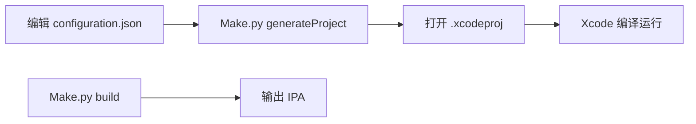

# iOS 客户端技术文档

> 路径：`teamgram-ios/docs/iOS客户端技术文档.md`  
> 基于 [Telegram-iOS](https://github.com/TelegramMessenger/Telegram-iOS) fork，使用 **Bazel** 构建，通过 MTProto 连接自建 Teamgram 服务端。

---

## 目录

1. [工程定位](#1-工程定位)
2. [目录结构](#2-目录结构)
3. [工具链](#3-工具链)
4. [配置体系](#4-配置体系)
5. [编译流程](#5-编译流程)
6. [服务端对接](#6-服务端对接)
7. [构建脚本](#7-构建脚本)
8. [相关文档](#8-相关文档)

---

## 1. 工程定位

| 项 | 说明 |
|----|------|
| 上游 | Telegram-iOS 开源客户端 |
| 构建 | `build-system/Make/Make.py` + Bazel |
| 输出 | `.xcodeproj`（开发）或 `.ipa`（发布） |
| 后端 | Teamgram `gnetway`（TCP `10443`、WebSocket `11443`） |

**注意**：须使用自有 `api_id` / `api_hash`（[Telegram API 申请](https://core.telegram.org/api/obtaining_api_id)），应用名不得冒用官方 Telegram 品牌。

---

## 2. 目录结构

```
teamgram-ios/
├── build-system/           构建配置、Make.py、签名脚本
│   ├── Make/               工程生成与编译入口
│   ├── example-configuration/
│   ├── template_minimal_development_configuration.json
│   └── teamgram-dev-configuration.json
├── submodules/             业务与网络核心（含 TelegramCore）
├── third-party/            音视频、加密等第三方源码
├── Telegram/               主应用与扩展 Target
├── versions.json           Xcode / Bazel / macOS 版本锁定
└── docs/                   本文档目录
```

**不修改** `third-party/`、`build-system/bazel-rules/` 内上游文档；Teamgram 自有说明仅放在 `docs/`。

---

## 3. 工具链

`versions.json` 指定版本，构建前 `Make.py` 会校验（可用 `--overrideXcodeVersion` 绕过）：

| 组件 | 当前锁定（以文件为准） |
|------|------------------------|
| App | 11.8.1 |
| Xcode | 16.2 |
| Bazel | 7.3.1 |
| macOS | 15 |

安装：Xcode（App Store 或开发者下载）、Bazel（`brew install bazelisk` 或官方安装包）。

---

## 4. 配置体系

### 4.1 JSON 配置（`generateProject` / `build`）

| 文件 | 用途 |
|------|------|
| `template_minimal_development_configuration.json` | 本地开发模板（需填 `team_id`、`bundle_id`） |
| `teamgram-dev-configuration.json` | 本仓库示例：`io.teamgram.Telegram` |
| `appstore-configuration.json` | App Store 发布模板 |
| `appcenter-configuration.json` | App Center |

字段说明：

| 字段 | 含义 |
|------|------|
| `bundle_id` | iOS Bundle Identifier |
| `api_id` / `api_hash` | Telegram API 凭证 |
| `team_id` | Apple Developer Team ID |
| `app_specific_url_scheme` | URL Scheme（如 `tg`） |
| `is_internal_build` | 内测构建标记 |
| `enable_siri` / `enable_icloud` | 扩展能力开关 |

### 4.2 Bazel 变量（`example-configuration/variables.bzl`）

供高级/CI 构建引用，与 JSON 配置等价，示例为官方 Telegram 包名；自建服请改为自有 `bundle_id`。

### 4.3 环境脚本（`verify.sh`）

导出 `API_ID`、`BUNDLE_ID`、描述文件等，供 CI 或 `prepare-build.sh` 链路使用。

---

## 5. 编译流程



| 场景 | 文档 |
|------|------|
| 本机开发、模拟器 | [快速编译指南.md](快速编译指南.md) |
| 改配置并打 IPA | [修改配置与打包.md](修改配置与打包.md) |
| 真机签名、商店包 | [高级编译指南.md](高级编译指南.md) |
| 排错 | [常见问题FAQ.md](常见问题FAQ.md) |

核心命令（仓库根目录）：

```bash
python3 build-system/Make/Make.py \
  --cacheDir="$HOME/telegram-bazel-cache" \
  generateProject \
  --configurationPath=build-system/teamgram-dev-configuration.json \
  --xcodeManagedCodesigning
```

---

## 6. 服务端对接

客户端默认连接 **Teamgram 网关**，非 Telegram 官方 DC。

| 配置位置 | 说明 |
|----------|------|
| `submodules/TelegramCore/Sources/Network/TeamgramGatewayHost.swift` | DC1 种子 IP（当前示例 `192.168.1.13`） |
| `Network.swift` | MTProto 端口 **10443** |

修改服务端 IP 后须同步改 `TeamgramGatewayHost.swift` 并重新编译。详见 [服务端对接配置.md](服务端对接配置.md)。

后端须已启动：`bash teamgram/scripts/start.sh`，且手机与服务器网络互通。

---

## 7. 构建脚本

| 脚本 | 说明 |
|------|------|
| `build-system/Make/Make.py` | 主入口：`generateProject`、`build` |
| `build-system/generate-xcode-project.sh` | 旧版 Tulsi 生成流程（部分环境仍用） |
| `build-system/prepare-build.sh` | 描述文件与构建变量准备 |
| `build-system/verify.sh` | CI 环境变量模板 |

Bazel 缓存建议：`--cacheDir="$HOME/telegram-bazel-cache"` 加速重复编译。

---

## 8. 相关文档

| 文档 | 主题 |
|------|------|
| [文档索引.md](文档索引.md) | 本目录导航 |
| [快速编译指南.md](快速编译指南.md) | 一步步本地编译 |
| [高级编译指南.md](高级编译指南.md) | 签名与发布 |
| [服务端对接配置.md](服务端对接配置.md) | IP / 端口 |
| [常见问题FAQ.md](常见问题FAQ.md) | 排错 |
| [贡献指南.md](贡献指南.md) | 贡献约定 |
| `../teamgram/docs/企业版安装指南.md` | 后端部署 |

---

*与 `versions.json`、`TeamgramGatewayHost.swift` 同步维护。*
