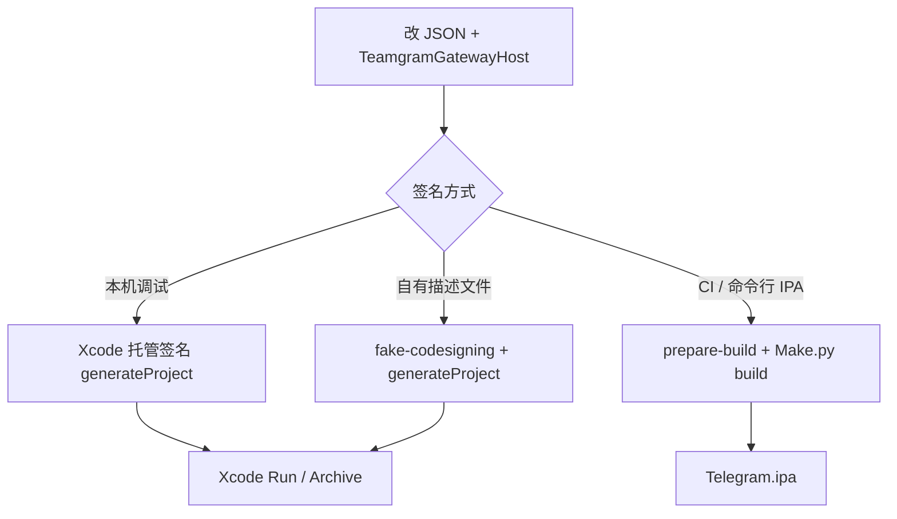

# 修改配置与打包

从改配置到产出 **IPA / 真机安装包** 的完整流程（Teamgram 自建服场景）。开发调试见 [快速编译指南.md](快速编译指南.md)。

---

## 一、要改哪些配置

Teamgram 客户端需改两类配置：**连哪个服务端**、**应用身份与签名**。

### 1.1 服务端（必改）

| 文件 | 改什么 |
|------|--------|
| `submodules/TelegramCore/Sources/Network/TeamgramGatewayHost.swift` | `ipv4` → Teamgram 服务器 IP |
| （一般不改）`Network.swift` | MTProto 端口固定 **10443** |

改完须重新编译。详见 [服务端对接配置.md](服务端对接配置.md)。

### 1.2 应用 JSON 配置（`--configurationPath`）

在 `build-system/` 下复制模板，**不要直接改** `appstore-configuration.json`（含官方示例值）：

```bash
cd teamgram-ios/build-system
cp teamgram-dev-configuration.json my-teamgram.json
# 或：cp template_minimal_development_configuration.json my-dev.json
```

| 字段 | 说明 | Teamgram 示例 |
|------|------|----------------|
| `bundle_id` | 包名，与 Apple 开发者后台 App ID 一致 | `io.teamgram.Telegram` |
| `api_id` | [my.telegram.org](https://my.telegram.org) 申请 | 数字字符串 |
| `api_hash` | 同上 | 32 位十六进制 |
| `team_id` | Apple Team ID（证书组织单位） | 10 位，如 `RVSAQ4323N` |
| `app_center_id` | App Center，不用填 `"0"` | |
| `is_internal_build` | 内测包 `"true"`，商店包 `"false"` | |
| `is_appstore_build` | 上架 App Store `"true"` | |
| `appstore_id` | App Store 应用 ID，未上架 `"0"` | |
| `app_specific_url_scheme` | URL Scheme，如 `tg`、`mychat` | |
| `premium_iap_product_id` | IAP 产品 ID，无则 `""` | |
| `enable_siri` | 是否启用 Siri 扩展 | `true` / `false` |
| `enable_icloud` | 是否启用 iCloud | `true` / `false` |

### 1.3 配置模板对照

| 文件 | 用途 |
|------|------|
| `teamgram-dev-configuration.json` | 本仓库本地开发示例 |
| `template_minimal_development_configuration.json` | 空白模板 + 占位符 |
| `appstore-configuration.json` | 商店发布参考（官方包名） |
| `appcenter-configuration.json` | App Center 分发参考 |

---

## 二、三种打包路径



---

## 三、路径 A：开发包（Xcode 托管签名）

适合：本机真机调试，不产出 IPA。

```bash
cd teamgram-ios

python3 build-system/Make/Make.py \
  --cacheDir="$HOME/telegram-bazel-cache" \
  generateProject \
  --configurationPath=build-system/my-teamgram.json \
  --xcodeManagedCodesigning
```

1. 打开生成的 `Telegram.xcodeproj`（路径见终端输出）
2. Xcode → Signing：选你的 Team，确认 `bundle_id` 与 JSON 一致
3. 选真机 → Run

仅模拟器时可加 `--disableProvisioningProfiles`。

---

## 四、路径 B：手动描述文件 + Xcode 工程

适合：多扩展（Share、Widget、通知等）与固定描述文件。

### 4.1 准备签名目录

```bash
cp -R build-system/fake-codesigning build-system/my-codesigning
```

在 Apple Developer 为 **主应用 + 各扩展** 创建 App ID 与描述文件（Development 或 Distribution）。`copy-provisioning-profiles-Telegram.sh` 需要的环境变量见下表。

| 环境变量 | 对应 Target |
|----------|-------------|
| `*_PROVISIONING_PROFILE_APP` | 主应用 Telegram |
| `*_EXTENSION_SHARE` | Share |
| `*_EXTENSION_WIDGET` | Widget |
| `*_EXTENSION_NOTIFICATIONSERVICE` | NotificationService |
| `*_EXTENSION_NOTIFICATIONCONTENT` | NotificationContent |
| `*_EXTENSION_INTENTS` | Siri Intents |
| `*_WATCH_APP` / `*_WATCH_EXTENSION` | Apple Watch（可选） |

`DEVELOPMENT_*` 用于开发；`DISTRIBUTION_*` 用于打包上架。

### 4.2 生成工程

```bash
export CODESIGNING_DATA_PATH=build-system/my-codesigning
# 按 copy-provisioning-profiles-Telegram.sh 设置各 PROVISIONING_PROFILE_* 变量后：

python3 build-system/Make/Make.py \
  --cacheDir="$HOME/telegram-bazel-cache" \
  generateProject \
  --configurationPath=build-system/my-teamgram.json \
  --codesigningInformationPath=build-system/my-codesigning
```

在 Xcode 中 Archive：**Product → Archive**，再导出 IPA。

---

## 五、路径 C：命令行直接打 IPA（推荐 CI）

适合：自动化流水线、内测分发。

### 5.1 环境变量（参考 `verify.sh`）

在 shell 或 CI 中导出（值改为你的）：

```bash
export BUILD_NUMBER=100001          # 必填，递增整数
export APP_VERSION=11.8.1           # 与 versions.json app 版本一致或自定
export BUNDLE_ID=io.teamgram.Telegram
export API_ID=你的api_id
export API_HASH=你的api_hash
export DEVELOPMENT_TEAM=你的TeamID
export APP_CENTER_ID=0
export IS_INTERNAL_BUILD=true
export IS_APPSTORE_BUILD=false
export APPSTORE_ID=0
export APP_SPECIFIC_URL_SCHEME=tg
export PREMIUM_IAP_PRODUCT_ID=
export TELEGRAM_DISABLE_EXTENSIONS=0   # 1=禁用扩展，简化签名

# Distribution 描述文件名称（与 copy-provisioning 脚本一致）
export DISTRIBUTION_PROVISIONING_PROFILE_APP="match AppStore io.teamgram.Telegram"
# ... 其余扩展同理，见 verify.sh
```

### 5.2 prepare-build

```bash
cd teamgram-ios/build-system
export CODESIGNING_DATA_PATH=./my-codesigning
sh prepare-build.sh Telegram distribution
```

生成：

- `build-input/data/variables.bzl` — Bazel 构建变量
- `build-input/data` 下描述文件副本

### 5.3 执行 build

在 **teamgram-ios 根目录**：

```bash
python3 build-system/Make/Make.py \
  --cacheDir="$HOME/telegram-bazel-cache" \
  build \
  --configurationPath=build-system/my-teamgram.json \
  --codesigningInformationPath=build-system/my-codesigning \
  --buildNumber="${BUILD_NUMBER}" \
  --configuration=release_arm64 \
  --outputBuildArtifactsPath="$(pwd)/build/artifacts"
```

| 参数 | 说明 |
|------|------|
| `--configuration=release_arm64` | 真机 Release（上架常用） |
| `debug_arm64` | 真机 Debug |
| `release_sim_arm64` | 模拟器 |
| `--buildNumber` | 写入 CFBundleVersion，**每次发包递增** |
| `--outputBuildArtifactsPath` | 指定 IPA 输出目录 |

成功后常见产物：

```
build/artifacts/Telegram.ipa
build/artifacts/*.dSYM   # 若开启 --generateDsym
```

### 5.4 版本与工具链

构建前确认 `versions.json`：

| 项 | 当前仓库锁定 |
|----|----------------|
| Xcode | 16.2 |
| Bazel | 7.3.1 |
| macOS | 15 |

版本不一致时：`--overrideXcodeVersion`（临时绕过）。

---

## 六、打包前检查清单

| # | 检查项 |
|---|--------|
| 1 | `TeamgramGatewayHost.swift` IP 为生产/测试可达地址 |
| 2 | 后端已启动，`10443`/`11443` 可连 |
| 3 | `api_id` / `api_hash` 有效且未泄露到公开仓库 |
| 4 | `bundle_id` 与描述文件、Apple 后台一致 |
| 5 | 主应用 + 全部扩展描述文件未过期 |
| 6 | `BUILD_NUMBER` 大于上一版本 |
| 7 | 应用显示名称与图标未冒用官方 Telegram（开源许可要求） |

---

## 七、常见问题

| 现象 | 处理 |
|------|------|
| 签名失败 / provisioning profile doesn't match | 核对 `bundle_id` 与描述文件 App ID |
| `BUILD_NUMBER not defined` | export `BUILD_NUMBER` 或传 `--buildNumber` |
| Bazel 编译极慢 | 使用 `--cacheDir="$HOME/telegram-bazel-cache"` |
| 安装后无法登录 | 查服务端 IP、防火墙、session 日志 |
| 仅需内测、不要扩展 | `TELEGRAM_DISABLE_EXTENSIONS=1` 减少描述文件数量 |

更多排错：[常见问题FAQ.md](常见问题FAQ.md)。

---

## 八、相关命令速查

```bash
# 1. 改配置
vim build-system/my-teamgram.json
vim submodules/TelegramCore/Sources/Network/TeamgramGatewayHost.swift

# 2. 开发：生成 Xcode 工程
python3 build-system/Make/Make.py --cacheDir="$HOME/telegram-bazel-cache" \
  generateProject --configurationPath=build-system/my-teamgram.json --xcodeManagedCodesigning

# 3. 发布：打 IPA
python3 build-system/Make/Make.py --cacheDir="$HOME/telegram-bazel-cache" \
  build --configurationPath=build-system/my-teamgram.json \
  --codesigningInformationPath=build-system/my-codesigning \
  --buildNumber=100002 --configuration=release_arm64 \
  --outputBuildArtifactsPath=build/artifacts
```

---

相关：[iOS客户端技术文档.md](iOS客户端技术文档.md)、[高级编译指南.md](高级编译指南.md)、`teamgram/docs/企业版安装指南.md`。
